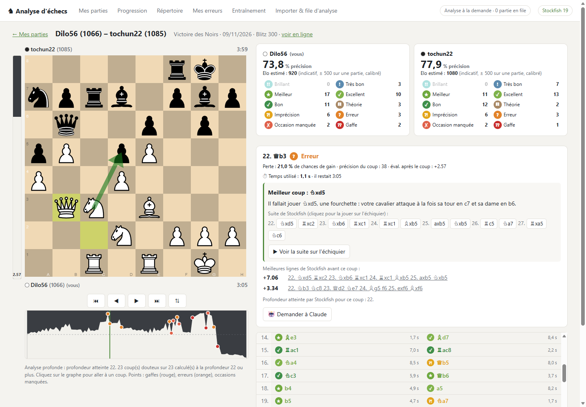
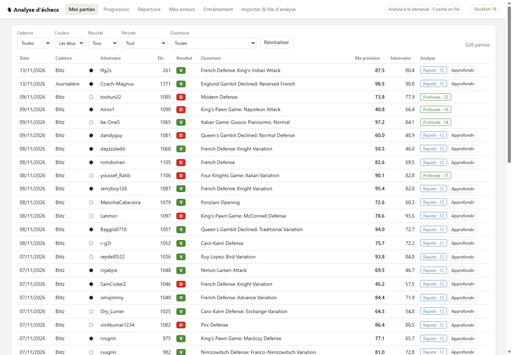
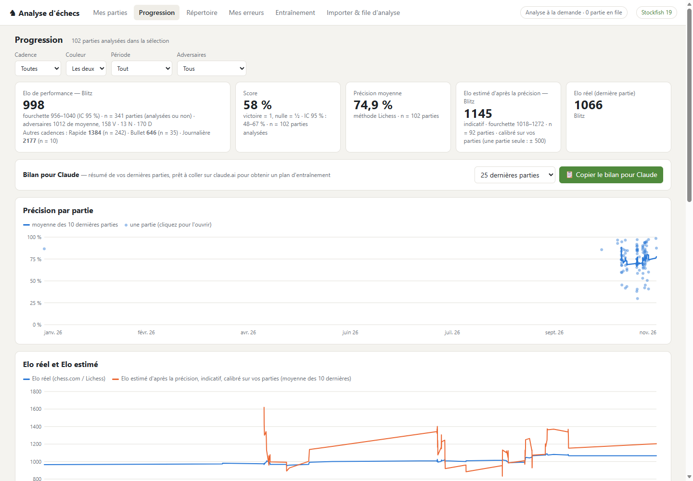
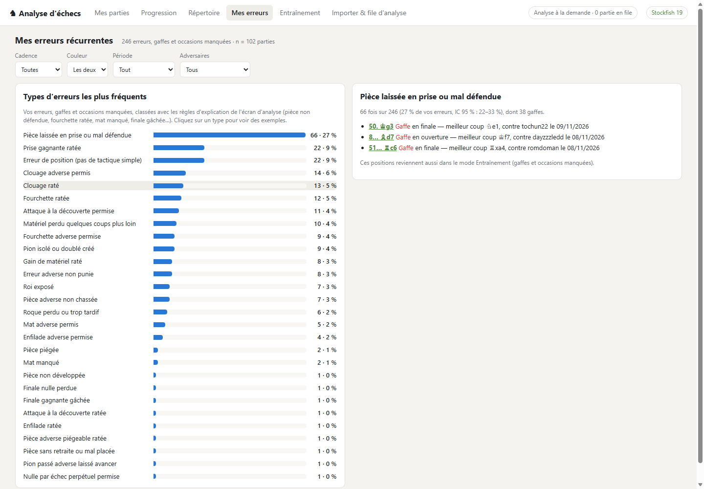

# Analyse d'échecs locale

Analysez vos parties d'échecs **sur votre propre ordinateur**, gratuitement et sans créer de compte. L'application
récupère vos parties chess.com et Lichess (ou un fichier PGN), les fait analyser par **Stockfish 19**, classe chaque
coup (classement inspiré de chess.com, ou seuils Lichess au choix), **explique vos erreurs en français** et suit votre
progression : Elo de performance par cadence, précision, erreurs récurrentes, répertoire d'ouvertures, gestion du
temps et puzzles tirés de vos propres gaffes. Tout reste chez vous ; seuls chess.com, Lichess et les sites de
téléchargement (Node.js, Stockfish) sont contactés.

| Mes parties | Progression | Mes erreurs récurrentes |
|---|---|---|
|  |  |  |

## Lancer l'application en 3 étapes

1. **Téléchargez** le dossier : sur GitHub, bouton vert **Code** → **Download ZIP**, puis décompressez-le
   (clic droit → *Extraire tout* sous Windows, double-clic sur Mac).
2. **Double-cliquez** sur `Lancer-Windows.bat` (Windows) ou `Lancer-Mac.command` (Mac ; la première fois :
   clic droit → *Ouvrir*). Au premier lancement, il faut Internet quelques minutes : le lanceur prépare tout seul
   Node.js et Stockfish, sans rien installer sur l'ordinateur.
3. Votre navigateur s'ouvre sur l'application. Dans **Importer & file d'analyse**, tapez votre pseudo chess.com ou
   Lichess, puis ouvrez une partie et cliquez sur **Analyser**.

Le reste de ce document détaille l'installation, l'utilisation, les réglages et les méthodes de calcul.

---

## 1. Installation

Rien à installer : téléchargez le dossier de l'application et double-cliquez sur le lanceur (voir ci-dessous).
Au premier lancement, il faut une connexion Internet :

- si **Node.js** 22.13 ou plus récent est déjà sur l'ordinateur, il est utilisé ; sinon le lanceur télécharge une
  **version portable** officielle de Node.js (24.22.3, environ 35 Mo) depuis <https://nodejs.org> dans le dossier
  `runtime/` de l'application. Sa somme SHA-256 est comparée à celle publiée par nodejs.org ; rien n'est installé
  sur le système et rien ne change pour les autres logiciels ;
- les composants de l'application (échiquier, règles des échecs) sont téléchargés une fois ;
- le moteur **Stockfish 19** (environ 80 Mo) est téléchargé depuis le site officiel
  <https://github.com/official-stockfish/Stockfish>, lui aussi avec vérification de l'empreinte du fichier.
  Windows (x64 et ARM), Mac (Apple Silicon et Intel) et Linux (x64 et ARM) sont pris en charge.

Pour tout désinstaller : supprimez le dossier de l'application.

## 2. Lancement

- **Windows** : double-cliquez sur `Lancer-Windows.bat`.
- **Mac** : double-cliquez sur `Lancer-Mac.command`.
  (Si le Mac refuse : clic droit → Ouvrir. S'il ne se passe rien, ouvrez le Terminal dans ce dossier et tapez `chmod +x Lancer-Mac.command`, une seule fois.)

Une fenêtre noire s'ouvre (laissez-la ouverte : c'est l'application), puis votre navigateur affiche
<http://127.0.0.1:3737>. Pour quitter : fermez la fenêtre noire (ou `Ctrl + C` dedans).
Si l'application est déjà ouverte, un nouveau double-clic rouvre simplement la page dans le navigateur.

L'application n'est accessible que depuis votre ordinateur (adresse 127.0.0.1), jamais depuis le réseau.

> Avant le premier import, créez un fichier `config.local.json` à côté de `config.json` (Bloc-notes) contenant
> `{ "contact": "votre@e-mail" }`. chess.com et Lichess demandent un moyen de contact dans les requêtes ; il n'est
> envoyé qu'à eux. Ce fichier est personnel : il n'est jamais publié et ses réglages remplacent ceux de `config.json`.

## 3. Utilisation

1. Dans **Importer & file d'analyse**, tapez votre pseudo chess.com et cliquez **Importer** : toutes vos parties terminées depuis la création du compte
   sont téléchargées (jamais une partie en cours). Même chose pour Lichess. Vous pouvez aussi coller un PGN ou
   déposer un fichier `.pgn`.
2. **Choisissez quelles parties analyser** (menu « Quelles parties analyser ? » dans *Importer & file d'analyse*) :
   - **Seulement les parties que je choisis** (réglage par défaut) : rien n'est analysé tant que vous ne cliquez pas
     sur **Analyser** (dans la liste ou sur l'écran d'une partie) ;
   - **Passe rapide sur toutes mes parties, profonde sur celles que je choisis** : quelques secondes par partie pour
     avoir la précision de toutes vos parties, l'analyse fine seulement à la demande ;
   - **Toutes mes parties automatiquement** : passe rapide puis passe profonde sur tout (très long sur un portable).

   Une partie demandée passe par la **passe rapide** (profondeur 12, quelques secondes) puis la **passe profonde**
   (environ 3 à 4 minutes par partie). La dernière partie demandée passe en premier. « Annuler la demande » la retire de la file.
3. Dans **Mes parties**, cliquez sur une partie pour ouvrir son écran d'analyse (voir ci-dessous). Les boutons
   **Analyser** (partie pas encore analysée) et **Approfondir** (déjà en passe rapide) sont aussi dans la liste.
4. **Pause / Reprendre** arrête et relance l'analyse. Si vous fermez l'application, elle reprend au prochain
   lancement là où elle en était (les positions déjà calculées sont gardées).
5. Aux lancements suivants, les comptes déjà importés sont **synchronisés automatiquement** : seuls le mois en
   cours et les nouveaux mois sont téléchargés (bouton **Synchroniser mes comptes** pour le faire à la demande).
6. **Analyser tout mon historique** (même écran) : toutes vos parties passent par la passe rapide puis la passe
   profonde, en priorité basse. Les parties que vous demandez passent toujours avant. L'écran indique le nombre de
   parties restantes et le temps estimé (d'après la durée de vos dernières analyses sur cet ordinateur). Boutons
   **Mettre en pause**, **Reprendre** et **Arrêter** ; la progression est gardée même si vous fermez l'application.

### Profondeur affichée : la vraie

La passe profonde ne calcule pas « à la profondeur 22 » : elle donne au moteur un budget de 1,5 million de positions
par coup, et la profondeur atteinte dépend de la position (souvent 14 à 20). L'application affiche donc **la
profondeur réellement atteinte** partout : dans la liste (« Profonde · 16 », détail en survolant), sous le graphe de la
partie (minimum, maximum, médiane) et pour chaque coup (« Profondeur atteinte par Stockfish pour ce coup : 17 »).

**Vérification à la profondeur 22.** Les coups qui comptent le plus — erreurs, gaffes, occasions manquées, très bons
coups et coups brillants — sont ensuite recalculés à la vraie profondeur 22 (sans limite de positions), puis la partie
est reclassée. Ces coups portent la mention « ✓ Vérifié par Stockfish à la profondeur 22 ». Une recherche qui avait
déjà atteint la profondeur 22, une table de finales ou une analyse cloud de Lichess assez profonde n'ont pas besoin
d'être revérifiées. Pour une partie analysée avant cette vérification, le bouton **Revérifier les coups douteux**
(écran de la partie) ne recalcule que ces coups ; « Analyser tout mon historique » le fait pour toutes vos parties.
Réglage : `engine.verifyDepth` (0 = pas de vérification).

### Combien de temps ça prend ?

Mesuré sur un portable AMD Ryzen 5 7520U (4 cœurs / 8 threads), sur une vraie partie blitz de 114 demi-coups :

| Analyse | Réglage | Durée de la partie |
|---|---|---|
| Passe rapide | profondeur 12 | environ 30 secondes |
| **Passe profonde (réglage actuel)** | **1,5 million de positions calculées par coup** (profondeur ≈ 15 à 20), puis vérification à 22 des coups douteux | **3 min 30 s**, plus quelques secondes à une minute par coup douteux |
| Passe profonde, budget doublé sur les coups douteux | `deepNodesCritical: 8000000` | 11 min 20 s |
| Passe profonde « maximale » (réglage d'origine) | profondeur 22 fixe (`deepNodes: 0`) | environ 45 minutes |

Pourquoi c'est plus rapide qu'avant :
1. **Budget fixe par coup** au lieu d'une profondeur fixe (comme Lichess) : le moteur ne passe plus 2 minutes sur une
   position compliquée.
2. **Théorie et parties déjà jouées** (≥ 97 % ou ≤ 3 % de chances de gain avant et après le coup) : on garde l'analyse
   rapide, le classement ne peut pas changer.
3. **Analyse de la fin vers le début** : la mémoire du moteur garde les positions suivantes, ce qui accélère les précédentes.
4. **Tous les cœurs et 1 Go de mémoire** : la file tourne en priorité basse, elle laisse donc la main à vos autres
   logiciels et au mode libre.

Ce que ça change : sur la partie mesurée, le classement est identique à celui de la profondeur 22 pour environ deux
coups sur trois ; les écarts sont surtout entre catégories voisines (meilleur / excellent, bon / imprécision), et
quelques erreurs de finale changent de catégorie. Pour retrouver exactement l'analyse d'origine (beaucoup plus lente),
mettez `"deepNodes": 0` dans `config.json`. Pour un compromis, augmentez `deepNodes` (par exemple 4000000).

C'est aussi pour cela que, par défaut, seules les parties que vous choisissez sont analysées.

### Mes parties (liste)

Filtres : **cadence** (bullet, blitz, rapide, classique, journalière), **couleur**, **résultat** (de votre point de vue),
**période** (7 jours, 30 jours, 3 mois, 12 mois ou dates précises) et **ouverture**. Pour chaque partie : date, adversaire
et son Elo, votre couleur (rond blanc ou noir), résultat (V / D / N), ouverture, votre précision et celle de
l'adversaire, statut d'analyse (rapide, profonde, en file, en cours) et un bouton **Analyser** / **Approfondir**.
Les filtres sont mémorisés.

### Écran d'analyse

- **Échiquier** orienté de votre côté (bouton ⇅ ou touche `F` pour le retourner) et **barre d'évaluation** verticale.
- **Graphe** des chances de gain des Blancs sous l'échiquier : cliquez dessus pour aller au coup. Les gaffes (rouge),
  erreurs (orange) et occasions manquées sont marquées par des points.
- **Liste des coups** avec symboles colorés : `!!` brillant, `!` très bon, `★` meilleur, `✓` excellent / bon,
  livre = théorie, `?!` imprécision, `?` erreur, `✗` occasion manquée, `??` gaffe, et le **temps utilisé** pour chaque
  coup (calculé à partir des pendules `%clk`).
- **Résumé par joueur** : précision, Elo estimé et compteurs cliquables (« Gaffe 2 » saute à la première gaffe, un
  nouveau clic à la suivante, puis on recommence).
- **Ouverture** (base libre lichess-org/chess-openings) et lien vers le **coup où l'on sort de la théorie**.
- **Clavier** : `←` / `→` coup précédent / suivant, `Début` / `Fin` (ou `↑` / `↓`) début / fin de partie.
- Pour chaque coup raté (imprécision, erreur, gaffe, occasion manquée) : la **flèche verte** du meilleur coup sur
  l'échiquier, le **meilleur coup**, une **explication en français** et la **suite de Stockfish**, jouable sur
  l'échiquier (cliquez un coup de la suite, ou « Voir la suite sur l'échiquier » pour la dérouler).

### Explications en français (par des règles)

Elles sont fabriquées par des règles à partir de la position et des lignes de Stockfish, dans cet ordre :
1. **Mat subi** : « Ce coup permet à l'adversaire de mater en N : … ».
2. **Finale gâchée** : « Finale gagnante gâchée : la table de finales confirme que … gagnait ».
3. **Pièce en prise / non défendue** : « Après ♗d3, votre fou en d3 n'est pas défendu : l'adversaire répond … et vous
   perdez une pièce ».
4. **Tactique adverse permise** : fourchette, clouage, enfilade, attaque à la découverte jouée par l'adversaire juste après.
5. **Mat raté** : « Vous aviez un mat en N : … ».
6. **Ce que le meilleur coup gagnait** : fourchette, clouage, enfilade, attaque à la découverte, prise gagnant du
   matériel (« La prise ♘xe5 gagnait du matériel : elle prend son cavalier en e5, qui n'était pas défendu »).
7. **Matériel qui tombe plus loin** (jusqu'à 10 demi-coups) : on suit la ligne de Stockfish jusqu'au coup où le
   matériel tombe et on nomme la tactique qui le fait tomber : fourchette, clouage, enfilade, découverte,
   **surcharge** (« votre dame en d2 ne pouvait pas défendre à la fois c3 et f4 ») ou **pièce piégée** (« votre fou en
   a7 n'avait plus aucune case sûre »). Un motif n'est retenu que si la pièce qu'il vise tombe vraiment ensuite. Sans
   tactique, on indique la pièce qui n'est plus défendue (« votre pion en e3 n'est plus défendu et ♕xe3+ le prend »).
8. **Règles de position**, quand aucun matériel n'est en jeu :
   - **échec perpétuel permis** : une position gagnante devient nulle par une suite d'échecs ;
   - **pion passé adverse laissé avancer** : il avance d'au moins deux cases (ou jusqu'à 3 cases de la promotion)
     dans la ligne jouée, moins dans la meilleure ;
   - **roi exposé** : l'adversaire enchaîne les échecs, les pièces adverses se massent autour du roi (hors finale),
     ou un pion de l'abri du roi avance ;
   - **roque perdu ou tardif** : le roi bouge sans roquer, une tour fait perdre le roque, il fallait roquer, ou le
     meilleur coup empêchait le roi adverse de roquer ;
   - **pièce non développée** : dans les 15 premiers coups, avec au moins deux pièces mineures encore chez elles, le
     meilleur coup en sortait une ;
   - **pièce sans retraite ou mal placée** : la pièce jouée n'a plus qu'une case sûre (ou aucune) et l'adversaire
     l'attaque, ou un cavalier / fou part au bord de l'échiquier avec deux cases sûres au plus ;
   - **pion isolé ou doublé créé** dans les 6 demi-coups qui suivent (et pas avec le meilleur coup) ;
   - **pièce adverse non chassée** : le meilleur coup attaquait une pièce adverse avec un pion ;
   - **roi passif en finale** : le meilleur coup rapprochait le roi du centre, ou le coup joué l'en éloigne.
9. Sinon : « Stockfish préférait X : la suite montre pourquoi » (type « Erreur de position »).

Mesuré sur les 246 erreurs, gaffes et occasions manquées des parties analysées de Dilo56 :

| Type d'explication | Avant | Après |
|---|---|---|
| Erreur de position (pas de tactique simple) | 48 (19,5 %) | 22 (8,9 %) |
| Matériel perdu quelques coups plus loin | 36 (14,6 %) | 10 (4,1 %) |
| Tactiques nommées (fourchette, clouage, enfilade, découverte, surcharge, pièce piégée), permises ou ratées | 65 (26,4 %) | 68 (27,6 %) |
| Pièce laissée en prise ou mal défendue | 46 (18,7 %) | 66 (26,8 %) |
| Nouvelles règles de position (roi, roque, développement, pions, pièces, finale) | – | 33 (13,4 %) |

### Mode libre

Jouez n'importe quel coup sur l'échiquier (glisser-déposer ou clic-clic), depuis n'importe quelle position : Stockfish
l'évalue en direct avec **le même classement** que l'analyse des parties. Un premier avis arrive en moins d'une seconde
(profondeur 12), puis il est affiné (profondeur 18, quelques secondes). Pendant ce temps, la file d'analyse de fond se
met en pause toute seule. Le bouton **↩ Revenir à la partie** remet la partie d'origine.

### Bouton « Demander à Claude »

Copie dans le presse-papiers une question prête à coller sur <https://claude.ai> : position (FEN), coups précédents,
coup joué, son classement, les 2 meilleures lignes de Stockfish avec leurs évaluations, votre Elo, et la question
« Explique-moi pourquoi mon coup est mauvais et quelle idée j'aurais dû voir ». Si le navigateur refuse l'accès au
presse-papiers, le texte s'affiche dans une fenêtre pour le copier à la main.

### Progression et entraînement

Ces écrans utilisent **vos parties analysées** (passe rapide ou profonde). Pour avoir des statistiques sur toutes
vos parties, choisissez « Passe rapide sur toutes mes parties » dans *Importer & file d'analyse* (environ 30 s à
1 min par partie sur un portable) : la passe profonde reste réservée aux parties que vous choisissez.

**Les statistiques se mettent à jour toutes seules** : chaque partie est calculée une fois, puis recalculée seulement
quand elle est (ré)analysée. Rien n'est refait inutilement.

**Progression** (tableau de bord) — filtres : cadence, couleur, période, adversaires plus forts / plus faibles.
- Courbes : précision par partie (et moyenne des 10 dernières), Elo réel et Elo estimé (une seule cadence à la fois,
  car l'Elo de blitz et celui de rapide ne se comparent pas). Cliquez sur un point pour ouvrir la partie.
- Précision par phase de jeu (moyenne de la précision de vos coups, hors coups de théorie). **Règle de découpage**,
  appliquée à la position avant chaque coup (inspirée de Lichess) :
  - **Finale** : 6 pièces ou moins sur l'échiquier, rois et pions non comptés ;
  - **Milieu de jeu** : dès que l'une de ces conditions est vraie : 10 pièces ou moins (rois et pions non comptés),
    un camp a moins de 4 pièces sur sa première rangée (il a développé), ou on a dépassé le 15e coup ;
  - **Ouverture** : avant. Une phase ne revient jamais en arrière.
- Nombre moyen de gaffes, erreurs, occasions manquées et imprécisions par partie, et leur évolution mois par mois.
- **Gestion du temps** (parties avec pendule, hors parties journalières) :
  - taux de coups ratés (erreur, gaffe, occasion manquée) quand il vous restait **moins de 30 s** au moment de
    réfléchir, comparé au reste de la partie ;
  - **coups évidents joués trop lentement** : un seul coup raisonnable (coup forcé, ou le 2e meilleur coup perd au
    moins 20 % de chances de gain), que vous avez trouvé, mais en plus de 5 s et plus du double de votre temps moyen ;
  - temps moyen par coup en ouverture, milieu de jeu et finale ;
  - **parties perdues au temps en position gagnante** (au moins 70 % de chances de gain à la fin).

**Répertoire** — l'arbre de vos parties avec les Blancs et avec les Noirs (profondeur réglable). Pour chaque coup :
nombre de parties, score (victoire = 1, nulle = ½) et précision moyenne. Les positions de la base d'ouvertures sont
marquées « théorie », et le premier coup hors théorie « sortie ». **Lignes à travailler** : celles où *vous* sortez de
la théorie et où ça tourne mal ensuite (vos chances de gain baissent d'au moins 10 % dans les 5 coups suivants, ou
vous marquez 35 % des points ou moins). Cliquez sur un coup ou une ligne pour voir les parties concernées.

**Mes erreurs** — vos erreurs, gaffes et occasions manquées classées par type, avec les règles d'explication de
l'écran d'analyse : mat adverse permis, mat manqué, finale gagnante gâchée, pièce laissée en prise ou mal défendue,
fourchette / clouage / enfilade / attaque à la découverte permise ou ratée, prise gagnante ratée, gain de matériel
raté, matériel perdu quelques coups plus loin, erreur adverse non punie, erreur de position. Chaque type a des
exemples cliquables.

**Entraînement** — vos **gaffes et occasions manquées deviennent des puzzles** : la position avant votre coup, à vous
de trouver le coup que vous aviez raté. Un autre coup presque aussi bon (moins de 3 % de chances de gain d'écart avec
celui de Stockfish) est accepté.
- **Répétition espacée** : raté → revient demain ; réussi → dans 3 jours, puis 7, 14 et 30 jours.
- **Session du jour** : 10 puzzles parmi ceux à réviser aujourd'hui et les nouveaux, en priorité les types d'erreurs
  que vous faites le plus (au plus 4 du même type, pour varier). La session reste la même toute la journée.
- Statistiques de réussite par type d'erreur.

**Bilan pour Claude** (en haut de *Progression*) — copie un résumé de vos N dernières parties analysées (10, 25, 50,
100 ou toutes) : résultats, Elo, précision par phase, fautes par partie, ouvertures, erreurs récurrentes, gestion du
temps et 5 positions typiques en FEN, avec la demande « Fais-moi un plan d'entraînement de 4 semaines adapté à ces
faiblesses ». Collez-le sur <https://claude.ai>.

---

## 4. Configuration (`config.json` et `config.local.json`)

`config.json` contient les réglages partagés (publiés avec le code). Pour vos réglages personnels, créez
`config.local.json` avec seulement les clés à changer, par exemple `{ "contact": "votre@e-mail", "engine": { "threads": 4 } }` :
il n'est jamais publié et remplace les valeurs de `config.json`.

Après une modification, fermez et relancez l'application.

| Réglage | Par défaut | Rôle |
|---|---|---|
| `contact` | `""` | Votre e-mail, ajouté à l'en-tête User-Agent des requêtes chess.com / Lichess |
| `port` | `3737` | Port de la page locale |
| `openBrowser` | `true` | Ouvre le navigateur au lancement |
| `autoSyncOnStart` | `true` | Synchronise les comptes au lancement |
| `analysisMode` | `"manual"` | Parties à analyser : `"manual"` (celles que vous choisissez), `"quick"` (passe rapide sur toutes, profonde à la demande), `"auto"` (tout). Le menu de l'application a la priorité sur ce réglage. |
| `engine.threads` | `"auto"` | Nombre de cœurs pour Stockfish (`"auto"` = tous, car la file tourne en priorité basse) |
| `engine.hashMB` | `"auto"` | Mémoire de Stockfish en Mo (`"auto"` = 1024 si l'ordinateur a au moins 12 Go, 512 si 6 Go, sinon 256) |
| `engine.multiPV` | `2` | Nombre de meilleures lignes calculées par position |
| `engine.quickDepth` | `12` | Profondeur de la passe rapide |
| `engine.deepNodes` | `1500000` | Passe profonde : positions calculées par coup (0 = profondeur fixe `deepDepth`, beaucoup plus lent) |
| `engine.deepDepth` | `22` | Profondeur fixe si `deepNodes` vaut 0 ; une évaluation déjà faite à cette profondeur est toujours réutilisée |
| `engine.deepNodesCritical` | `0` | Si > 0 : budget plus gros pour les coups douteux (perte ≥ 2 %) |
| `engine.verifyDepth` | `22` | Erreurs, gaffes, occasions manquées, très bons et brillants revérifiés à cette profondeur (0 = jamais) |
| `engine.deepSkipDecided` | `97` | Passe profonde : garder l'analyse rapide quand la partie est déjà jouée (≥ 97 % ou ≤ 3 %) ; 100 = jamais |
| `engine.maxSecondsPerPosition` | `300` | Sécurité : temps maximum par position |
| `engine.liveDepth` | `18` | Profondeur de l'analyse en direct du mode libre (16 = plus rapide) |
| `engine.backgroundLowPriority` | `true` | La file de fond tourne en priorité basse (l'ordinateur reste fluide) |
| `lichess.cloudEval` | `true` | Utiliser l'analyse cloud Lichess pour les positions connues |
| `lichess.cloudEvalMaxPly` | `30` | Interroger le cloud seulement pendant les 30 premiers demi-coups |
| `lichess.cloudEvalInQuickPass` | `false` | Utiliser aussi le cloud pendant la passe rapide |
| `lichess.tablebase` | `true` | Utiliser les tables de finales Lichess |
| `lichess.tablebaseMaxPieces` | `7` | Nombre maximum de pièces (rois compris) pour les tables |
| `lichess.timeoutMs` | `6000` | Délai d'attente d'une réponse Lichess |
| `lichess.pauseAfterRateLimitSec` | `60` | Pause de la source Lichess après un « trop de requêtes » (429) |
| `lichess.pauseAfterErrorSec` | `120` | Pause de la source Lichess après une panne |
| `classification.preset` | `"chesscom"` | `"chesscom"` (inspiré de chess.com) ou `"lichess"` (seuils 5 / 10 / 15 %) ; se change aussi dans l'application, qui retient le choix |
| `classification.thresholds` | `2.5 / 6 / 12 / 22` | Seuils de perte (voir ci-dessous) |
| `classification.lowElo` | sous 1400 : `3 / 7.5 / 14 / 26` | Seuils plus indulgents sous 1400 Elo |
| `classification.greatMinGap` | `10` | Écart minimal (%) avec le 2e coup pour « Très bon » |
| `classification.greatIgnoreRecaptures` | `true` | Une simple reprise de pièce n'est jamais « Très bon » |
| `classification.brilliantMinSacrifice` | `2` | Matériel minimum sacrifié (en points) pour « Brillant » |
| `classification.brilliantMaxLoss` | `1` | Perte maximale (%) d'un coup brillant |
| `classification.brilliantMaxWinBefore` | `90` | Pas de brillant si la position était déjà gagnante à plus de 90 % |
| `classification.missKeepIfWorseThanBeforeError` | `5` | Voir « Occasion manquée » |
| `accuracy.uncertaintyBonus` | `0` | Lichess ajoute +1 à la précision de chaque coup imparfait ; mettez `1` pour l'imiter |
| `elo.minMoves` | `8` | Nombre minimum de coups hors théorie pour estimer un Elo |
| `elo.table` | voir §5.4 | Table précision → Elo (générique, avant calibrage) |
| `elo.calibrate` | `true` | Recentre l'Elo estimé sur votre niveau réel (voir §5.4) |
| `elo.calibrationMinPoints` | `15` | Nombre minimum de joueurs-parties pour calibrer une cadence |

---

## 5. Méthodes de calcul

### 5.1 Chances de gain

Chaque évaluation est convertie en **chances de gain** (formule Lichess), du point de vue du joueur concerné :

    Gain% = 50 + 50 × (2 / (1 + e^(−0,00368208 × cp)) − 1)

- Un **mat en N** vaut 100 % (pour celui qui mate) ou 0 % (pour celui qui est maté). Les mats ne passent jamais
  dans la formule en centipions.
- Une position des **tables de finales** vaut 100 % (gagnée), 50 % (nulle) ou 0 % (perdue).

### 5.2 Classement des coups

Ce classement est **inspiré de chess.com** : chess.com ne publie pas son algorithme, les catégories sont les mêmes
mais les seuils ci-dessous sont les nôtres. Un réglage permet d'utiliser à la place les **seuils Lichess (5 / 10 / 15 %)**
(voir plus bas).

Pour chaque position, Stockfish calcule les **2 meilleurs coups** (MultiPV 2). Si le coup joué n'est pas parmi eux,
il est évalué à la même profondeur avec `searchmoves`. La **perte** est :

    perte = Gain%(meilleur coup) − Gain%(coup joué), toujours du point de vue du joueur qui vient de jouer.

| Catégorie | Règle |
|---|---|
| **Théorie** | Tant que chaque position atteinte figure dans la base libre [lichess-org/chess-openings](https://github.com/lichess-org/chess-openings) (y compris les positions intermédiaires des lignes) |
| **Brillant** | Sacrifice d'au moins 2 points de matériel qui tient sur les coups suivants, perte < 1 %, position pas déjà gagnante à plus de 90 % avant le coup |
| **Très bon** | Le joueur a joué le meilleur coup et c'était le seul qui tient : écart > 10 % avec le 2e coup du MultiPV |
| **Meilleur** | Le coup du moteur (ou une perte ≤ 0,1 %) |
| **Excellent** | perte < 2,5 % |
| **Bon** | perte < 6 % |
| **Imprécision** | perte < 12 % |
| **Erreur** | perte < 22 % |
| **Gaffe** | perte ≥ 22 % |
| **Occasion manquée** | L'adversaire vient de faire une erreur ou une gaffe, et le coup joué ne la punit pas (perte ≥ 12 %) |

**Seuils sous 1400 Elo** (Elo du joueur qui joue, lu dans la partie) : excellent < 3 %, bon < 7,5 %,
imprécision < 14 %, erreur < 26 %, gaffe au-delà. L'occasion manquée utilise alors 14 %.

Précisions :
- **Sacrifice « qui tient »** : on suit la ligne principale du moteur après le coup. Le joueur doit être en déficit
  d'au moins 2 points (pion 1, cavalier/fou 3, tour 5, dame 9) après la réponse adverse **et** encore après son coup
  suivant (ce n'est donc pas un simple échange). La perte de matériel doit aussi être *évitable* : si la meilleure
  autre ligne perd le même matériel (pièce déjà perdue), ce n'est pas un sacrifice. Pas de brillant en étant en échec.
- **Occasion manquée** : si le coup joué rend la position pire qu'avant l'erreur adverse (de plus de 5 %),
  il reste classé erreur/gaffe, car il ne s'agit plus seulement d'une occasion ratée.
- **Très bon** : une simple reprise de pièce (prendre sur la case où l'adversaire vient de prendre) n'est pas
  comptée, sinon presque chaque échange produirait un « Très bon » (réglage `greatIgnoreRecaptures`).

**Réglage « Seuils Lichess (5 / 10 / 15 %) »** (écran *Importer & file d'analyse*, carte « Classement des coups ») :
imprécision dès 5 % de chances de gain perdues, erreur dès 10 %, gaffe dès 15 %, comme Lichess, quel que soit l'Elo.
Les autres catégories (meilleur, excellent, très bon, brillant, occasion manquée) restent calculées comme ci-dessus.
Changer de réglage **reclasse toutes les parties déjà analysées** en quelques secondes : la perte de chaque coup est
déjà enregistrée, seuls les seuils changent (aucune position n'est recalculée, et revenir au réglage précédent redonne
exactement le même classement). Les statistiques et les puzzles suivent. Un coup qui devient
douteux avec les nouveaux seuils sans avoir été vérifié à la profondeur 22 rend la partie « à revérifier ».

### 5.3 Précision

- **Par coup** (formule Lichess) : `103,1668 × e^(−0,04354 × perte) − 3,1669`, bornée entre 0 et 100.
- **Par partie** (méthode Lichess complète) : moyenne de
  (a) la moyenne des précisions **pondérée par la volatilité** — le poids d'un coup est l'écart-type des chances de
  gain sur une fenêtre glissante (taille = nombre de coups / 10, entre 2 et 8), borné entre 0,5 et 12 — et
  (b) la **moyenne harmonique** des précisions par coup (qui punit fortement les gaffes).

### 5.4 Elo de performance et Elo estimé

**Elo de performance (tuile principale du tableau de bord).** Pour chaque cadence (bullet, blitz, rapide…), sur toutes
vos parties de la sélection, analysées ou non :

    Elo de performance = Elo moyen des adversaires + 400 × (victoires − défaites) / nombre de parties

C'est une mesure directe de vos résultats, sans dépendre du moteur. Sa **fourchette** vient de l'intervalle de
confiance à 95 % du score (méthode de Wilson, voir 5.6) : comme (V − D) / N = 2 × score − 1, la fourchette va de
adversaires + 400 × (2 × bas − 1) à adversaires + 400 × (2 × haut − 1). L'Elo d'une cadence n'est pas comparable à
celui d'une autre : la tuile affiche la cadence filtrée (ou la plus jouée) et résume les autres en dessous.

**Elo estimé d'après la précision (indicateur secondaire, indicatif).** Affiché avec sa fourchette (moyenne ± 1,96 ×
écart-type / √n) et la mention « indicatif ». Calcul :

La précision de la partie est convertie en Elo par **interpolation linéaire** dans cette table :

| Précision | 40 | 55 | 65 | 72 | 78 | 83 | 87 | 90 | 93 | 96 | 100 |
|---|---|---|---|---|---|---|---|---|---|---|---|
| Elo | 400 | 800 | 1100 | 1350 | 1600 | 1850 | 2100 | 2350 | 2600 | 2850 | 3200 |

Aucun Elo n'est estimé si le joueur a joué moins de 8 coups hors théorie. La table est modifiable dans `config.json`.

**Calibrage sur vos parties.** Cette table générique ne connaît pas votre niveau : sur les parties de Dilo56 (blitz,
analyse rapide), elle donnait en moyenne **1580 au lieu de 1008** (vos parties et celles de vos adversaires). Dès que
15 joueurs-parties d'une cadence sont analysés, l'application recentre la table sur votre niveau réel :

    Elo estimé = Elo de la table générique + décalage de la cadence

Le décalage est la **médiane** de (Elo réel − Elo de la table) sur vos parties analysées de cette cadence, en comptant
aussi vos adversaires, dont l'Elo réel est connu. La médiane résiste aux parties atypiques, par exemple contre un
robot. Une cadence avec trop peu de parties utilise le décalage toutes cadences confondues. Le calibrage se met à
jour tout seul quand de nouvelles parties sont analysées. Il se désactive avec `"calibrate": false` dans
`config.json`.

Mesuré sur vos parties (calibrage appris sur les 70 % les plus anciennes, testé sur les 30 % les plus récentes) :

| Erreur moyenne par rapport à l'Elo réel | Table générique | Calibrée |
|---|---|---|
| Une partie isolée | 815 points | 570 points |
| Moyenne sur 10 parties (la courbe du tableau de bord) | 754 points | 226 points |

L'estimation d'**une** partie reste très imprécise : la précision varie énormément d'une partie à l'autre (de 40 % à
98 % chez le même joueur). Fiez-vous plutôt à la **moyenne sur plusieurs parties**. Le calibrage garde la pente de la
table (combien d'Elo vaut un point de précision) : vos parties couvrent un Elo trop étroit pour la mesurer.

### 5.5 Sources d'évaluation

Pour chaque position, dans cet ordre :
1. **Cache local** : une position (FEN normalisée : pièces, trait, roques, prise en passant) déjà évaluée à une
   profondeur suffisante n'est jamais recalculée.
2. **Tables de finales Lichess** (`tablebase.lichess.ovh`) si 7 pièces ou moins, sans droit de roque : résultat exact.
3. **Analyse cloud Lichess** (`lichess.org/api/cloud-eval`) pour les positions connues (passe profonde, 30 premiers
   demi-coups, arrêt après 2 positions inconnues de suite), si sa profondeur est au moins celle demandée.
4. **Stockfish 19** en local.

Si Lichess ne répond pas, est lent ou limite le débit (erreur 429), la source est mise en pause quelques minutes et
l'analyse continue avec Stockfish seul, sans erreur.

### 5.6 Fiabilité des statistiques

Un score de 60 % sur 5 parties ne veut presque rien dire ; sur 200 parties, si. Les écrans de statistiques
(Progression, Répertoire, Mes erreurs, Entraînement) et le « Bilan pour Claude » appliquent donc trois règles :

1. **n affiché à côté de chaque statistique** : nombre de parties (ou de coups, ou d'essais) sur lequel elle porte.
2. **Moins de 10 parties : grisé**, avec la mention « échantillon trop petit ». Dans les courbes mois par mois, un mois
   de moins de 10 parties est dessiné par un point creux.
3. **Intervalle de confiance à 95 %** (méthode de Wilson) pour les scores et les taux (score, taux de coups ratés
   selon la pendule, part de chaque type d'erreur, réussite aux puzzles…). Survolez une valeur pour le voir.
   **Une différence n'est présentée comme réelle que si les deux intervalles ne se chevauchent pas** : par exemple,
   « vous ratez 2 fois plus de coups sous 30 s » n'est affiché que si c'est démontré ; sinon l'écran indique « pas de
   différence démontrée ». Dans le répertoire, un score n'est coloré (vert ou rouge) que s'il est nettement au-dessus
   ou en dessous de votre score moyen avec cette couleur.

Méthode de Wilson, pour k réussites sur n (une nulle compte ½), avec z = 1,96 :
centre = (p + z²/2n) / (1 + z²/n) et demi-largeur = z·√(p(1−p)/n + z²/4n²) / (1 + z²/n), où p = k/n.

---

## 6. Où sont mes données ?

Tout est dans le dossier `data/` :
- `data/echecs.sqlite` : la base (joueurs, parties avec PGN et pendules `%clk`, positions, évaluations, classements, file d'analyse) ;
- `data/engine/` : Stockfish ;
- `runtime/` (s'il existe) : la version portable de Node.js téléchargée par le lanceur.

Comptez environ 20 Mo pour 1 000 parties. Pour tout recommencer : supprimez `data/echecs.sqlite` (application fermée).

### Sauvegardes

- **Automatiques** : au démarrage, si la dernière sauvegarde a plus de 24 h, et avant chaque mise à jour de la
  structure de la base (nouvelle version de l'application). Elles sont rangées dans `data/backups/` ; les **7 dernières**
  sont gardées.
- **Contrôle d'intégrité** à chaque démarrage. Si la base est endommagée, l'analyse s'arrête et un bandeau propose de
  restaurer la dernière sauvegarde saine.
- Dans *Importer & file d'analyse* : **Exporter ma base** (télécharge une copie complète, à garder sur une clé USB par
  exemple), **Sauvegarder maintenant**, et **Restaurer** une sauvegarde de la liste. Avant toute restauration, la base
  actuelle est elle-même sauvegardée : on peut toujours revenir en arrière.
- Pour réinstaller l'application ailleurs : copiez votre export dans `data/` sous le nom `echecs.sqlite`.

## 7. Tests automatiques

Dans un terminal ouvert dans ce dossier :

    npm test

Ce sont les **tests unitaires** : rapides (une quinzaine de secondes), sans Stockfish et sans Internet. Le moteur y est
remplacé par un faux programme UCI (`test/fake-uci.js`) qui rejoue des réponses de Stockfish enregistrées dans
`test/fixtures/uci/`, et le réseau est coupé : seules des réponses d'API enregistrées (`test/fixtures/http/`) sont servies.

    npm run test:integration

Ce sont les **tests d'intégration** : les mêmes vérifications avec le vrai Stockfish et le vrai réseau (tables de
finales Lichess), plus un test de l'application complète. Comptez une à deux minutes.

Si l'analyse change et demande d'autres positions au moteur, un test unitaire signale « Position non enregistrée » :
`npm run test:record` réenregistre alors les réponses avec le vrai Stockfish et les vraies API.

Les tests vérifient notamment les règles de l'étape 3 (découpage en phases, pendule sous 30 s, coups évidents trop lents,
défaites au temps, répétition espacée 1 / 3 / 7 / 14 / 30 jours, choix de la session, recalcul incrémental des
statistiques, bilan pour Claude), les filtres de la liste, l'ouverture et la sortie de théorie, les explications (pièce en prise,
fourchette, clouage, enfilade, découverte, mat raté ou subi, finale gâchée), le mode libre, et aussi : mat en 2 trouvé, mat en 2 raté (gaffe), dame laissée en prise (gaffe), coups de théorie,
finale à 6 pièces (doit venir de la table), partie de plus de 150 coups, partie abandonnée au 3e coup, cache par FEN,
repli sur Stockfish quand Lichess est injoignable, import chess.com (429, incrémental, parties terminées seulement),
import Lichess et PGN (pendules, doublons, parties en cours refusées).

`npm run smoke` lance un test de fumée : l'application démarre dans un dossier temporaire, installe Stockfish si
besoin et analyse une courte partie. Les lanceurs ont aussi un mode test (`Lancer-Windows.bat --test`,
`./Lancer-Mac.command --test`) qui fait ce test au lieu d'ouvrir l'application.

À chaque envoi sur GitHub, l'intégration continue (`.github/workflows/ci.yml`) refait tout cela sur Windows, macOS
(Apple Silicon et Intel) et Linux : installation des dépendances, tests unitaires, installation de Stockfish, tests
d'intégration, puis les lanceurs eux-mêmes avec téléchargement de Node.js portable.

## 8. Problèmes fréquents

| Problème | Solution |
|---|---|
| « Impossible de préparer Node.js » | Le téléchargement de Node.js portable a échoué : vérifiez la connexion Internet et relancez. |
| « Node.js … est trop ancien » | Lancez l'application avec le fichier `Lancer-…` (et non `npm start`) : il utilise une version portable récente. |
| « La somme SHA-256 ne correspond pas » | Le fichier téléchargé est abîmé ou a été modifié : il est supprimé, relancez simplement. |
| « Le port 3737 est déjà utilisé » | L'application est déjà ouverte : allez sur <http://127.0.0.1:3737>. Sinon changez `port` dans `config.json`. |
| Le navigateur ne s'ouvre pas | Ouvrez vous-même <http://127.0.0.1:3737>. |
| Le téléchargement de Stockfish échoue | Vérifiez la connexion Internet et relancez ; le téléchargement reprend du début. Antivirus : autorisez `data/engine`. |
| « Stockfish ne démarre pas » | Votre système n'est peut-être pas pris en charge (Windows/Mac/Linux 64 bits requis). Supprimez `data/engine` et relancez. |
| L'import chess.com est lent | Normal : les mois sont téléchargés un par un, poliment. Les fois suivantes, seul le mois en cours est relu. |
| « Pseudo introuvable » | Vérifiez l'orthographe du pseudo (sans @). |
| Lichess « en pause » en haut de la page | Lichess limite le débit : l'analyse continue avec Stockfish, Lichess revient tout seul. |
| L'analyse profonde est très lente | Voir « Combien de temps ça prend ? » ; vérifiez que `deepNodes` n'est pas à 0, ou baissez-le (par exemple 1000000). |
| L'ordinateur chauffe / ventile | Mettez **Pause**, ou baissez `engine.threads` (par exemple 2). |
| Une partie est « en erreur » | Bouton « Relancer les parties en erreur ». Un PGN illisible reste signalé dans la liste. |
| L'échiquier ne s'affiche pas | Fermez l'application et relancez le fichier `Lancer-…` : il installe les composants manquants. |
| « Demander à Claude » ne copie rien | Le navigateur bloque le presse-papiers : le texte s'affiche alors dans une fenêtre, sélectionnez-le et faites Ctrl+C. |
| Le mode libre est lent | Baissez `engine.liveDepth` (par exemple 16) dans `config.json`. |
| Mac : « fichier endommagé » ou non ouvrable | Clic droit → Ouvrir, ou dans le Terminal : `npm start`. |

## 9. Respect des API

- chess.com (PubAPI) : requêtes l'une après l'autre (jamais en parallèle), en-tête User-Agent avec contact,
  nouvelles tentatives espacées et de plus en plus longues en cas d'erreur 429, ETag pour ne pas retélécharger un mois inchangé.
- Lichess : une seule requête à la fois, attente d'au moins une minute après une erreur 429.
- Seules les **parties terminées** sont importées (archives mensuelles chess.com, `finished=true&ongoing=false` sur
  Lichess, résultat `*` refusé pour les PGN) : l'application ne peut pas servir à tricher pendant une partie.

### Réponses inattendues

Le format des réponses de chess.com et de Lichess est vérifié (profil, liste des mois, parties : PGN, date de fin,
pseudos, identifiant…). Si quelque chose ne va pas, l'import **ne s'arrête pas** :
- une partie au format inattendu est ignorée, les autres sont importées ;
- un mois chess.com illisible est ignoré pour cette fois et sera redemandé à la prochaine synchronisation ;
- une ligne illisible de l'export Lichess est ignorée ;
- à la fin, l'écran *Importer & file d'analyse* l'indique en clair, par exemple : « Terminé : 120 nouvelles parties.
  Attention : 2 éléments ignorés (format inattendu) : partie sans PGN (champ « pgn » absent) (2) ».

Seule une liste des mois illisible arrête l'import chess.com, avec un message qui le dit (il n'y a alors rien à lire).
Les tests s'appuient sur de vraies réponses enregistrées (`test/fixtures/api/`), puis sur des versions abîmées exprès.

### Mettre à jour le livre d'ouvertures

    npm run update-openings

Télécharge la dernière version de [lichess-org/chess-openings](https://github.com/lichess-org/chess-openings)
(licence CC0), vérifie chaque ligne (en-tête, colonnes, code ECO, coups légaux) puis remplace les fichiers de
`resources/openings/`. Si un fichier est abîmé, rien n'est modifié. La version téléchargée est notée dans
`resources/openings/SOURCE.txt`, et les noms d'ouverture des parties sont recalculés au lancement suivant.

## Licence

Ce logiciel est distribué sous licence **GNU GPL version 3** (ou toute version ultérieure) : voir le fichier
[`LICENSE`](LICENSE). Vous pouvez l'utiliser, l'étudier, le modifier et le redistribuer ; une version modifiée que
vous distribuez doit rester sous la même licence, avec son code source.

## Licences tierces

| Composant | Rôle | Licence | Comment il est utilisé |
|---|---|---|---|
| [Stockfish](https://github.com/official-stockfish/Stockfish) | moteur d'analyse | GPL-3.0 | binaire officiel téléchargé au premier lancement (empreinte SHA-256 vérifiée), jamais modifié |
| [chessground](https://github.com/lichess-org/chessground) | échiquier de l'interface (celui de Lichess) | GPL-3.0-or-later | dépendance npm, avec ses pièces « cburnett » |
| [chess.js](https://github.com/jhlywa/chess.js) | règles des échecs, lecture des PGN | BSD-2-Clause | dépendance npm |
| [lichess-org/chess-openings](https://github.com/lichess-org/chess-openings) | livre d'ouvertures (noms, codes ECO) | CC0-1.0 | copié dans `resources/openings/` (`npm run update-openings`) |

Les formules de chances de gain et de précision suivent celles publiées par
[Lichess](https://github.com/lichess-org/lila) ; elles sont réécrites ici, aucun code de Lichess n'est copié.
Node.js, téléchargé par les lanceurs s'il manque, est distribué par nodejs.org sous licence MIT.
